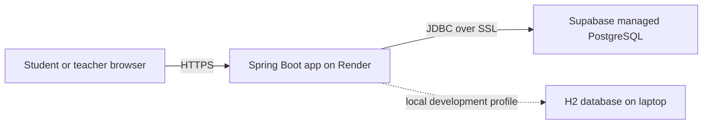

# CloudQuiz — Cloud-Based Quiz and Assessment System

A Spring Boot project for managing short, scheduled classroom quizzes. The starter data includes one 10-question quiz for each of the five requested subjects. Teachers can edit all questions, choices, answer keys, schedule, duration, and result visibility.

## Features

- Separate student and teacher sign-in, protected by Spring Security and BCrypt password hashing.
- Five subject-specific teacher accounts; each teacher can manage only their subject's quizzes.
- Teachers can change their own password from the teacher portal after confirming the current password.
- Ten multiple-choice questions per quiz, four choices each, 2 marks each (20 marks total).
- Teacher-editable quiz title, questions, options, correct answers, start date/time, duration (1–180 minutes), and score visibility.
- Students see a locked status until the scheduled time, can make one attempt, and receive a 15-minute default timer.
- Every answer is saved to the database when selected. A browser timer submits at zero, and a server-side scheduled task closes expired attempts too. Only saved choices are marked.
- The quiz page sends answer-save requests with Spring Security's CSRF header and waits for pending saves before final submission.
- Student self-registration for student accounts; successful sign-ins are timestamped and visible to teachers.
- Teacher result page lists student name, username, start time, attempt status, and score.
- Local H2 database for a quick IntelliJ run; PostgreSQL for the free cloud deployment; optional MySQL profile.

## Technology

Java 21 · Spring Boot 3.5 · Spring MVC · Thymeleaf · Spring Security · Spring Data JPA · H2 / PostgreSQL / MySQL

## 1. Run locally in IntelliJ IDEA

1. Install **JDK 21** and IntelliJ IDEA Community or Ultimate.
2. Extract this ZIP. In IntelliJ, choose **File → Open** and select the `cloud-quiz-assessment` folder (the folder containing `pom.xml`). Trust the project and allow Maven to import dependencies.
3. Open `src/main/java/com/campus/quiz/CloudQuizApplication.java` and click the green run icon beside `main`.
4. Wait for the console message showing the application started on port `8080`.
5. Open [http://localhost:8080](http://localhost:8080) in a browser.

### Demo sign-ins

| Role | Username | Password |
|---|---|---|
| Student | `student1` | `Student@123` |
| Advanced Java teacher | `java_teacher` | `Java@123` |
| Cloud Computing teacher | `cloud_teacher` | `Cloud@123` |
| Computer Networks teacher | `networks_teacher` | `Networks@123` |
| Frontend Engineering teacher | `frontend_teacher` | `Frontend@123` |
| Aptitude teacher | `aptitude_teacher` | `Aptitude@123` |

These are demonstration credentials. Students can use **Create an account** from the login page and should enter their college ID and a unique password. Teachers can change their demo password after signing in.

### Try the project

1. Sign in as a teacher and choose **Create quiz**.
2. Set a title, choose a start time, set the duration, and decide whether marks will be shown after submission.
3. Edit all 10 questions, their four options, and the correct answer. Save the quiz. Question content locks after the first student attempt so existing answer records remain accurate; create a new quiz for a new question set.
4. Sign out and sign in as `student1`. Before the selected time, the quiz is locked; after it, start the quiz and choose answers. Answers save as they are selected.
5. Submit the quiz or let the timer reach zero. If the result setting is on, the student sees their score; the teacher can see the full attempt record and registered students' last login time on the teacher dashboard.

### Local data

The local H2 database is stored in `data/quizdb` inside the project folder and survives restarts. To reset the demo database, stop the application and delete the `data` folder; the demo accounts and starter quizzes are recreated the next time the app starts.

### Optional MySQL run

The app also includes a MySQL profile. Install MySQL Server and create a database named `cloudquiz`, then set these IntelliJ Run Configuration environment variables:

```text
SPRING_PROFILES_ACTIVE=mysql
DB_USERNAME=root
DB_PASSWORD=your_mysql_password
```

Then run the same `CloudQuizApplication`. The default, simplest local setup remains H2.

### Run from IntelliJ while connected to Supabase

After creating the Supabase project and copying its **Session pooler** details from the Connect panel, you can use the cloud database from your laptop too:

1. Open **Run → Edit Configurations** in IntelliJ and select the `CloudQuizApplication` run configuration.
2. Add these environment variables, using your Supabase session-pooler host, port, username, and database password:

```text
SPRING_PROFILES_ACTIVE=cloud
DATABASE_URL=jdbc:postgresql://POOLER_HOST:POOLER_PORT/postgres?sslmode=require
DB_USERNAME=postgres.PROJECT_REF
DB_PASSWORD=your_database_password
```

3. Apply and run. The header should say **SUPABASE CLOUD**. Remove `SPRING_PROFILES_ACTIVE=cloud` (or set it to `local`) to switch back to local H2. Keep the database password in IntelliJ/Render environment settings, never in Java files or GitHub.

## 2. Free cloud deployment (Render + Supabase)

The app server runs on Render and stores quiz/account data in Supabase PostgreSQL. The database is external to the app container, so app restarts do not erase quiz records.

### A. Create the free database

1. Create a Supabase account and a new **Free** project. Keep the database password somewhere safe.
2. Choose a region close to your users.
3. Open the project's **Connect** panel and choose **Session pooler**. Copy its host, port, database, username, and password. The session pooler is appropriate for a persistent backend on an IPv4-only host like Render's free service. Supabase's direct endpoint may require IPv6.
4. Use the host and port exactly as shown in the dashboard. Do not share the password or commit it to GitHub.

### B. Push this project to GitHub

1. Create a new empty GitHub repository.
2. In IntelliJ, open the Terminal at the project folder and run:

```bash
git init
git add .
git commit -m "Initial CloudQuiz project"
git branch -M main
git remote add origin https://github.com/YOUR-USERNAME/YOUR-REPOSITORY.git
git push -u origin main
```

Replace the final URL with the repository URL GitHub shows you. Do not add database passwords or `.env` files to GitHub.

### C. Deploy the app to Render

1. Create a Render account, select **New → Web Service**, and connect the GitHub repository.
2. Select the repository branch `main`. Render detects the included `Dockerfile`; choose the **Free** instance.
3. Add these environment variables in the service's **Environment** section:

| Key | Value |
|---|---|
| `SPRING_PROFILES_ACTIVE` | `cloud` |
| `DATABASE_URL` | `jdbc:postgresql://POOLER_HOST:POOLER_PORT/postgres?sslmode=require` |
| `DB_USERNAME` | Supabase session-pooler username, usually `postgres.PROJECT_REF` |
| `DB_PASSWORD` | Your Supabase database password |

Replace `POOLER_HOST`, `POOLER_PORT`, and `PROJECT_REF` with the exact connection details from Supabase's **Session pooler** connection string. If the password has URL-reserved symbols, prefer entering it only in `DB_PASSWORD`, not in the URL.

4. Click **Create Web Service** and wait for the first Docker build and deploy to finish.
5. Open the `onrender.com` URL from the Render dashboard. The database tables and demo accounts/quizzes are created automatically on first startup.
6. Use the demo logins above to demonstrate both portals.

### Free tier notes

- Render free web services sleep after 15 minutes without traffic; their first request after sleeping can take about a minute to wake.
- Supabase Free projects may pause after a week of low activity. Resume a paused project from its dashboard. Keep a backup of important demo data; free resources are for learning and demonstrations, not a production exam system.
- Free limits and provider signup requirements can change. Check the provider dashboards before relying on them for a scheduled assessment.

## Project structure

```text
src/main/java/com/campus/quiz/
  config/       Security configuration and demo data seeding
  controller/   Student, teacher, and login routes
  model/        User, subject, quiz, questions, attempts, saved answers
  repo/         Spring Data JPA repositories
  service/      Quiz rules, scoring, and timeouts
  web/          Teacher quiz form objects
src/main/resources/
  templates/    Thymeleaf login, student, and teacher pages
  static/css/   Responsive interface styling
```

## Cloud computing concept demonstrated

The web application is deployed to a hosted cloud runtime (Render), while the records are stored in a managed cloud PostgreSQL database (Supabase). The app connects to the database over an encrypted connection using environment-based secrets. This demonstrates cloud hosting, managed database service, remote access, environment configuration, and a simple web application architecture.



### Short project explanation for a presentation

“CloudQuiz is a role-based assessment system. Teachers create subject-specific quizzes, set the start time, duration, and score visibility, and can change questions before students begin. Students sign in, wait for a scheduled quiz to unlock, and answer ten multiple-choice questions. Each answer is saved as it is selected, and the server closes timed-out attempts and calculates the score. For the cloud computing part, the Spring Boot application runs on Render and quiz/user records are stored in Supabase's managed PostgreSQL database. Locally, the same app uses H2 so it can be demonstrated without a cloud account.”
